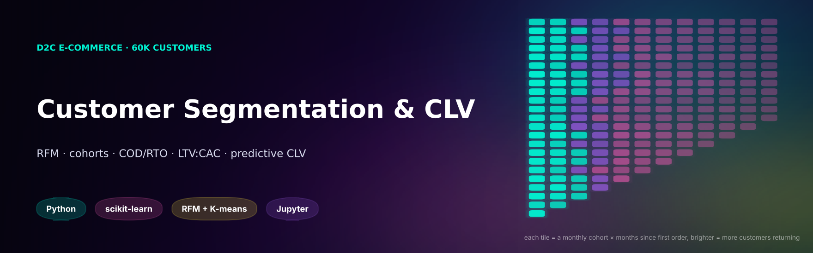
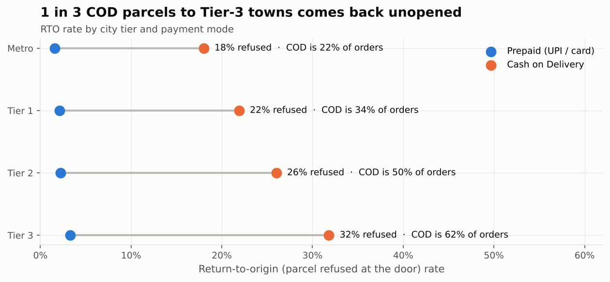
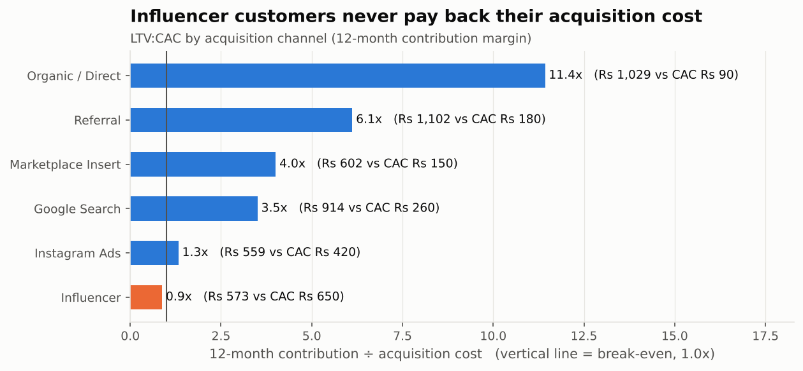
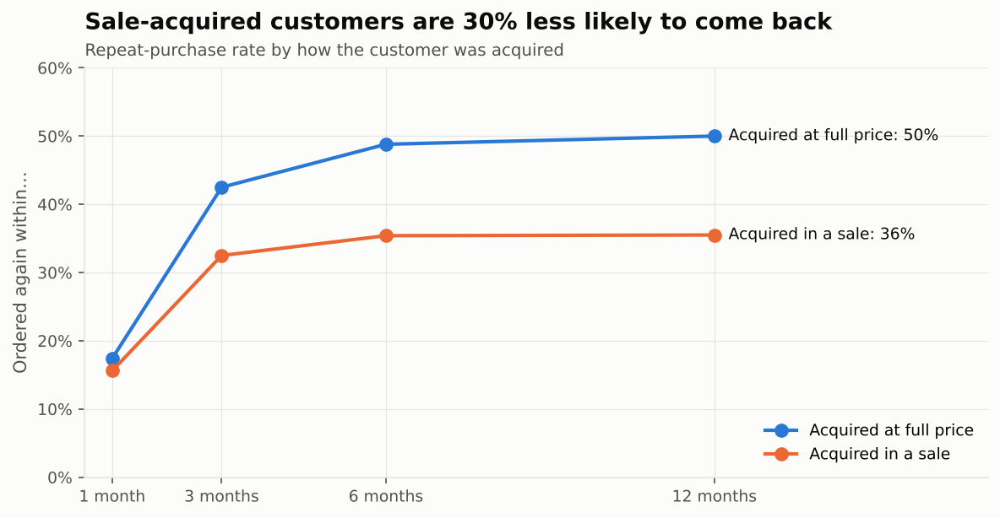
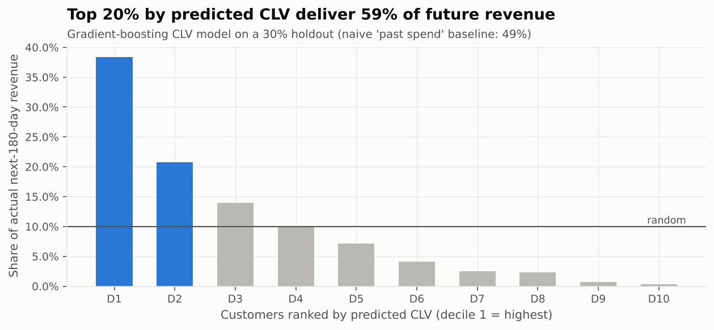
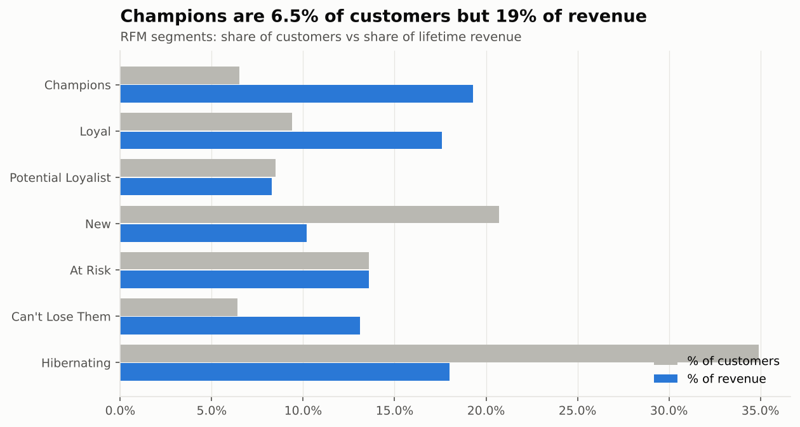
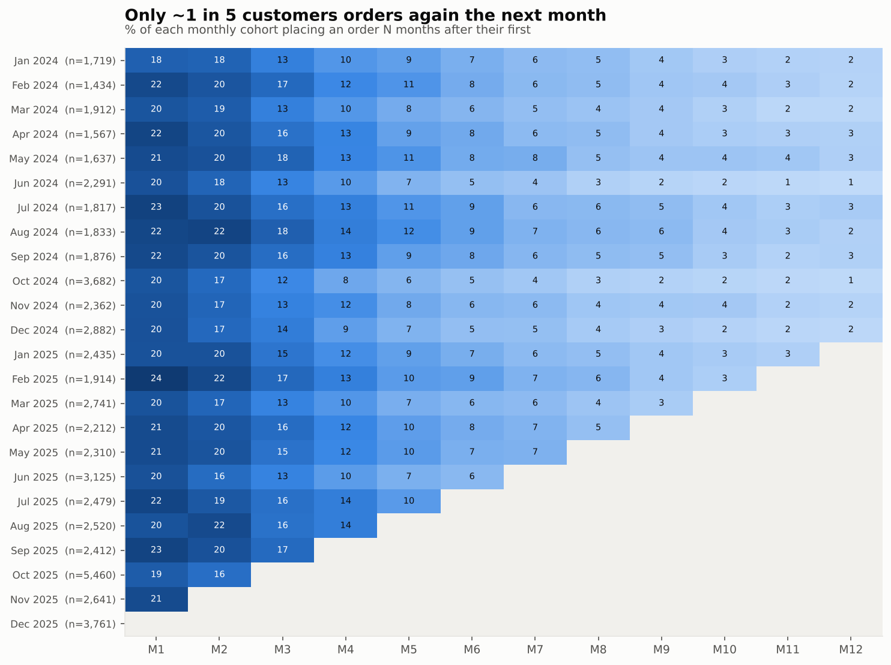

<p align="center"></p>

<p align="center">
  
  
  
  
  
</p>

# Customer Segmentation, Retention and CLV for an Indian D2C Brand

**The question:** a beauty and personal-care D2C brand grew revenue from ₹2.9 Cr (2024) to ₹4.8 Cr (2025), but only **42% of customers ever order twice**.
Who are the valuable customers? Which channels and offers bring customers who stay? How much is Cash-on-Delivery costing?

**The answer** is in one executed notebook: [`notebooks/customer_analytics.ipynb`](notebooks/customer_analytics.ipynb).
It covers RFM segmentation with an action playbook, cohort retention, K-means validation, COD/RTO unit economics,
LTV:CAC by channel, and a gradient-boosting model that predicts a customer's next-180-day value from their first 90 days.

> **Data note:** synthetic data generated by [`src/generate_data.py`](src/generate_data.py): 60K customers and 120K orders across 32 Indian cities, 2024–2025.
> India-specific behaviour is built in: COD and RTO, Tier-2/3 towns, Diwali and end-of-season sales, influencer acquisition.

---

## Findings at a glance

| | Finding | So what |
|---|---|---|
| 💸 | **1 in 3 COD parcels to Tier-3 towns is refused at the door** (31.8% RTO, vs 3.3% prepaid). COD is 62% of Tier-3 orders. | Every refused parcel burns ₹135 in two-way shipping, and a refused *first* order usually loses the customer. |
| 🧮 | A **₹40 prepaid incentive** that moves 30% of COD orders online avoids ~1,700 RTOs a year, for a **net benefit of ₹7.9 lakh/year** after the incentive cost. The notebook has a sensitivity grid. | Launch "₹40 off on UPI" at checkout, starting with Tier-2/3 pincodes. |
| 🏷️ | **Sale-acquired customers are 30% less likely to return** (35.5% vs 50.0% repeat within 12 months). | Judge sale campaigns on 12-month value, not day-one orders. Push sale-acquired cohorts into a second-purchase journey. |
| 📣 | **Influencer customers never pay back** (LTV:CAC 0.9x): big first basket, 28% repeat. **Referral (6.1x) and organic (11.4x)** are the best channels. | Move influencer budget into a referral programme. Keep influencers for awareness only, measured on CAC. |
| 👑 | **Champions are 6.5% of customers and 19% of revenue.** "Can't Lose Them" (6.4%, high value, lapsed 445 days) hold another 13%. | Exported CRM list with an action per segment: [`reports/segment_playbook.csv`](reports/segment_playbook.csv). |
| 🤖 | The CLV model ranks customers after just 90 days: **the top 20% it picks deliver 59% of next-180-day revenue**, vs 49% for "rank by past spend" (R² 0.21 vs 0.11). | Spend retention budget on the top two deciles from day 90. |
| 🧴 | Skincare customers re-order after a **median of 34 days** (haircare 38, makeup 47). | Send the "running low?" reminder at day 28 for skincare. |
| 🔬 | K-means (k=3, best silhouette 0.38) independently finds the same structure: **high-value repeaters, recent one-timers, lapsed one-timers**. | Validates that the rule-based RFM segments reflect real structure. |

<p align="center">
  
  
</p>
<p align="center">
  
  
</p>
<p align="center">
  
  
</p>

---

## Methods

| Analysis | How | Where |
|---|---|---|
| **Unit economics** | Contribution per order after product margin (68%), shipping, COD fee, gateway fee, RTO and returns. All assumptions are constants at the top of the module so they can be challenged. | `add_order_economics()` |
| **Cohort retention** | Monthly first-order cohorts × months since. Unobserved future months are masked, not shown as 0%. | `cohort_matrix()` |
| **RFM** | R and M on quintiles. **F on fixed thresholds**, because most customers have exactly one order and quintiles would split identical customers arbitrarily. 7 named segments, each with an action. | `rfm()`, `segment_summary()` |
| **K-means** | log1p → standardise → k chosen by silhouette on a sample → cross-tab against RFM segments. | `kmeans_segments()` |
| **COD/RTO** | RTO rate by tier × payment mode, plus a what-if for prepaid incentives (shift % × incentive ₹ grid). | `rto_analysis()`, `prepaid_nudge_scenario()` |
| **LTV:CAC** | 12-month contribution margin per acquired customer (only customers with a full 12 months observed) ÷ channel CAC. | `ltv_by_channel()` |
| **Predictive CLV** | `HistGradientBoostingRegressor` with native categorical features. Features come from the first 90 days only (orders, spend, discount %, COD share, RTO, categories, tier, channel). Target: next-180-day spend. Evaluated with decile capture against a naive baseline. A test checks there is no look-ahead leakage. | `clv_features()`, `train_clv_model()` |

## Run it

```bash
pip install -r requirements.txt
python src/generate_data.py                 # 3 s
cd notebooks && jupyter nbconvert --to notebook --execute --inplace customer_analytics.ipynb
pytest -q                                   # data integrity, economics, RFM coverage, cohort masking, model sanity, leakage
```

## Structure

```
├── notebooks/customer_analytics.ipynb   the analysis, executed, with outputs
├── src/
│   ├── generate_data.py                 synthetic D2C order history (seeded)
│   ├── analytics.py                     all analysis functions (tested)
│   └── charts.py
├── reports/segment_playbook.csv         segment → size → value → recommended action
├── images/                              charts
├── assets/                              banner (generated from the cohort data)
└── tests/
```

---

**Author:** Husein Ghadiali · Data Analyst · I built RFM segmentation that lifted marketing ROI 20% in a previous role · [LinkedIn](https://linkedin.com/in/husein-ghadiali)
